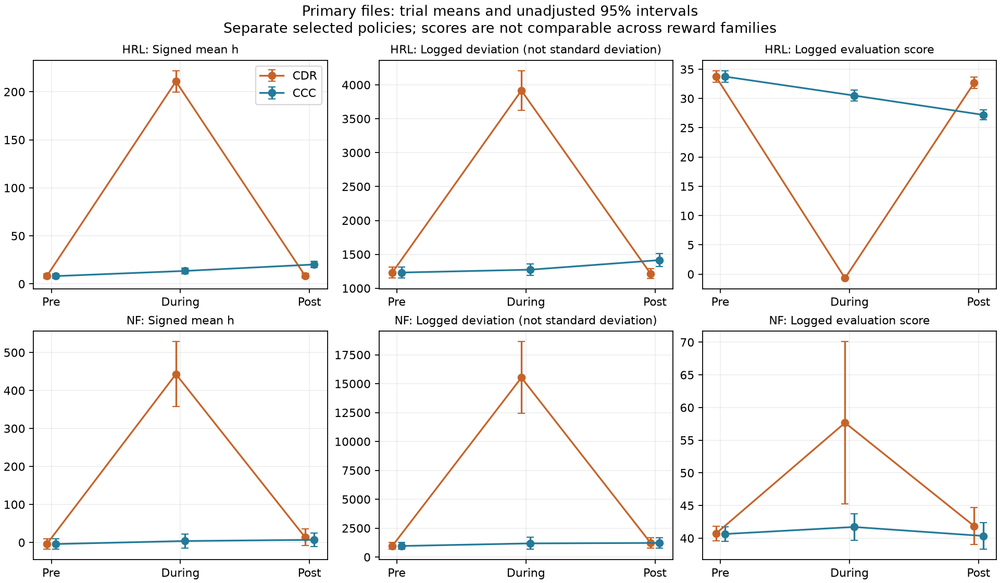

# Paper update package — 17 October 2026

This package reconciles the current decanalization project with `D:/Dev/Modeling-Decanalization/modelingDecanalization.tex` and `appendix.tex`. It proposes paper edits; the original manuscript and frozen source data have not been edited. A subsequent authorized implementation fixes project reward/dispersion logging and adds provenance for reruns. See [resolved decisions](OPEN_ITEMS.md) and [implementation](rerun-update/IMPLEMENTATION.md). Comments and proposed instructions embedded in the manuscript were treated as reference material, not as instructions to execute.

## Read first

1. [Change inventory](CHANGE_INVENTORY.md): old paper statements, recovered implementation, and evidence status.
2. [Proposed manuscript edits](MANUSCRIPT_EDITS.md): replacement prose, equations, results, appendix settings, and figure plan.
3. [Results and limitations](RESULTS.md): newly computed primary comparisons and supplementary traversal-rate evidence.
4. [Items to resolve before submission](OPEN_ITEMS.md): resolved author decisions and remaining rerun work.

## Findings from the frozen legacy inputs

- Each of the four selected primary YAML files contains **250 complete trials**, with three phase records per trial. Together they provide 1,000 evaluations and 3,000 phase records, not 1,000 independently trained policies.
- HRL post-intervention signed mean h is **8.60 for CDR versus 20.23 for CCC**; its logged evaluation score is **32.68 versus 27.21**. NF has no clear post-intervention contrast on these measures in the exploratory analysis.
- The supplementary rates **4, 6, and 7** (author-confirmed counted visits per actual tile entry) reduce post-intervention HRL scores by **10.0%, 14.6%, and 15.2%**, respectively, relative to the primary HRL-CDR file. Signed state means also move farther above zero. These experiments support a bounded adverse-effect claim; they are not additional primary conditions.
- Training reward and the YAML evaluation score are **different computations**. Calling `reward-total` either the new training reward or a critic prediction would be misleading.
- The logged `setpoint-dev` implementation is **root summed squared deviation**, not standard deviation. Signed mean h is not mean absolute error.
- Current settings include speed 5,000 cm/s, grid-width parameter 50, passive-loss parameter 0.5, pellet draws from [5,35], and training termination at |h| > 100. Current defaults do not by themselves establish settings used for every historical run.
- HRL and NF now have different effective optimizer settings. The old statement that only their reward rules and snapshots differ must be revised.

## Contents and reproduction

`inputs/` freezes the seven analyzed files. `input_manifest.json` records SHA-256 hashes, roles, IDs, and counts. `evidence/` contains copied asset exports, searchable graph nodes, current class defaults, source-log matches, selected trainer configurations, and supporting source records. `source_manifest.json` records provenance and source hashes. `package_manifest.json` inventories deliverables.

`build_analysis.py` regenerates the CSVs and primary PNG/PDF figure from the frozen inputs. Run with Python 3.12 and numpy, scipy, PyYAML, and matplotlib installed. In the original project it also detects `Saved/AnalysisPython`. A Windows command for the present workspace is:

```powershell
& 'C:\Users\jingo\.cache\codex-runtimes\codex-primary-runtime\dependencies\python\python.exe' 'D:\Dev\decanalization\analysis\paper-update-2026-10-17\build_analysis.py'
```

`audit_assets.py` summarizes the exported Blueprint copies and requires the project's `analysis/timing/graph_asset.py`. The copies were exported with UAssetAPI; every export reported binary equality. This is a saved-asset audit, not a new Unreal simulation or proof of placed-instance settings at evaluation time.

`supplement_results.png` / `.pdf` shows the post-intervention traversal-rate comparisons separately. The rates 4, 6, and 7 are the author's explicit mappings, superseding the old report's interpretation. The appendix settings and reward equations are supplied as reviewable text in MANUSCRIPT_EDITS.md; no replacement manuscript was silently applied.

Statistical checks validate unique trial IDs, condition labels, phase order, complete phases, finite values, and equal logged durations. Means, SDs, medians, unadjusted 95% intervals, Welch contrasts, and Holm adjustments are regenerated. No trials were excluded. Existing reports were not used as the source of updated statistics.



## Authorized rerun update

`rerun-update/` packages the validated implementation, corrected Blueprint assets, selected training manifests, and engineering smoke-test outputs. `source_manifest.json` and `evidence/` remain the original historical audit; they do not describe the subsequently installed assets. New asset hashes are recorded in `rerun-update/installed_assets.json` after installation. Use `package_followup.py` to rebuild this expanded ZIP while preserving historical evidence; `package_evidence.py` is the original audit packager.

The actual primary reruns remain to be performed. Eight short validation trials are not included in the paper's frozen analysis. See `analysis/trial_metrics/README.md` in the project for the rerun protocol.
