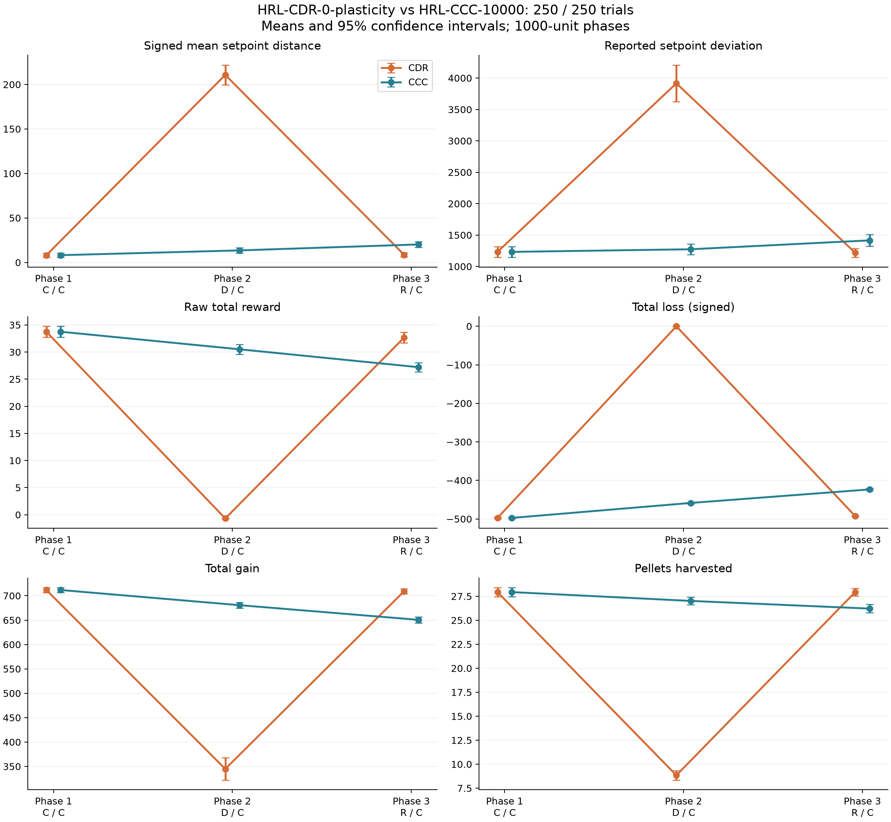
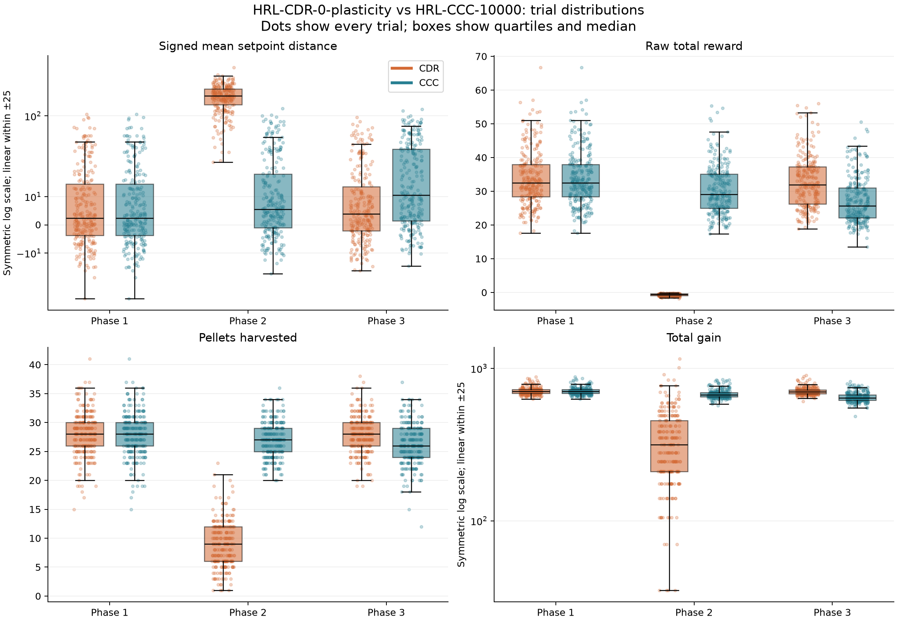

# HRL-CDR-0-plasticity vs HRL-CCC-10000

Validated complete trials: CDR 250, CCC 250.
Every trial has all three ordered phases; each phase has logged duration 1000.
Only the two named YAML inputs are used. Rewards are raw; totals require no duration rescaling.

## Interpretation: 0 plasticity versus uninterrupted canalization

0 plasticity means ordinary overlap counting during decanalization, not absence
of decanalization. Initial setpoint and resource measurements match exactly by
trial ID. Baseline reward differs in one trial by only 0.000452.

The 0-plasticity CDR run has a large phase-2 disturbance, but its final-phase
measurements are better on reward, signed mean offset and logged deviation than
uninterrupted CCC. These statements describe observed metrics, not improved
learning or lower verified mean absolute error.

- reward-total: CDR mean 32.68 versus CCC 27.21. Baseline-adjusted difference +5.47, 95% CI [3.63, 7.30], Holm-adjusted p=3.77e-08.
- setpoint-avg: CDR mean 8.60 versus CCC 20.23. Baseline-adjusted difference -11.63, 95% CI [-16.74, -6.52], Holm-adjusted p=2.93e-05.
- setpoint-dev: CDR mean 1216.69 versus CCC 1415.51. Baseline-adjusted difference -198.82, 95% CI [-361.91, -35.73], Holm-adjusted p=0.017.
- gains-harvested: CDR mean 27.94 versus CCC 26.22. Baseline-adjusted difference +1.72, 95% CI [0.86, 2.59], Holm-adjusted p=0.000194.

These p-values use the 12-test baseline-change family defined below; CIs are
unadjusted. Lower logged setpoint deviation is not a verification of its formula
or a test of equal variance across trial-level means.

The final advantage does not offset the acute cost: mean summed reward across
all three phases is 65.73 in CDR versus 91.47
in CCC, or 28.1% lower in CDR.
These are descriptive per-trial sums over equal total logged durations.

CDR also retains greater final-phase gain and more negative loss. The findings
are consistent with decanalization changing subsequent resource turnover and
the state trajectory, but aggregates cannot distinguish that mechanism from
recovery transients or other unverified configuration differences. The 1× run
remains near its own initial levels while CCC changes over time.

## Phase means

| metric | phase | CDR | CCC |
| --- | --- | --- | --- |
| gain-total | 1 | 711.72 | 711.72 |
| gain-total | 2 | 344.82 | 680.65 |
| gain-total | 3 | 709.28 | 650.58 |
| gains-harvested | 1 | 27.936 | 27.936 |
| gains-harvested | 2 | 8.84 | 27.016 |
| gains-harvested | 3 | 27.94 | 26.216 |
| loss-total | 1 | -497.34 | -497.34 |
| loss-total | 2 | 0 | -458.53 |
| loss-total | 3 | -492.7 | -423.41 |
| reward-total | 1 | 33.747 | 33.747 |
| reward-total | 2 | -0.68854 | 30.51 |
| reward-total | 3 | 32.675 | 27.21 |
| setpoint-avg | 1 | 8.1588 | 8.1588 |
| setpoint-avg | 2 | 210.75 | 13.533 |
| setpoint-avg | 3 | 8.5974 | 20.227 |
| setpoint-dev | 1 | 1232.3 | 1232.3 |
| setpoint-dev | 2 | 3916.2 | 1274.3 |
| setpoint-dev | 3 | 1216.7 | 1415.5 |

## Phase medians

| metric | phase | CDR | CCC |
| --- | --- | --- | --- |
| gain-total | 1 | 705.65 | 705.65 |
| gain-total | 2 | 315 | 671.15 |
| gain-total | 3 | 702.71 | 642.11 |
| gains-harvested | 1 | 28 | 28 |
| gains-harvested | 2 | 9 | 27 |
| gains-harvested | 3 | 28 | 26 |
| loss-total | 1 | -501.58 | -501.58 |
| loss-total | 2 | 0 | -459.99 |
| loss-total | 3 | -494.48 | -426.5 |
| reward-total | 1 | 32.54 | 32.54 |
| reward-total | 2 | -0.59366 | 29.103 |
| reward-total | 3 | 31.887 | 25.704 |
| setpoint-avg | 1 | 2.4142 | 2.4142 |
| setpoint-avg | 2 | 207.34 | 5.5466 |
| setpoint-avg | 3 | 3.9231 | 10.565 |
| setpoint-dev | 1 | 1006.1 | 1006.1 |
| setpoint-dev | 2 | 3282.3 | 984.88 |
| setpoint-dev | 3 | 1002.9 | 1065.6 |

Means and medians can differ substantially. Inspect both and the individual-trial
distribution plot before interpreting average reward or average signed state.

## Between-condition comparisons

Differences are CDR minus CCC. Two-sided Welch tests; Holm adjustment across
these 18 comparisons. Confidence intervals are unadjusted 95% intervals.

| metric | phase | difference | ci95_low | ci95_high | p_holm |
| --- | --- | --- | --- | --- | --- |
| setpoint-avg | 1 | 0 | -3.4476 | 3.4476 | 1 |
| setpoint-avg | 2 | 197.22 | 185.62 | 208.81 | 1.3657e-99 |
| setpoint-avg | 3 | -11.63 | -15.613 | -7.6472 | 1.4971e-07 |
| setpoint-dev | 1 | 0 | -116.57 | 116.57 | 1 |
| setpoint-dev | 2 | 2642 | 2337.5 | 2946.4 | 1.1618e-44 |
| setpoint-dev | 3 | -198.82 | -317.48 | -80.16 | 0.0074799 |
| reward-total | 1 | 1.808e-06 | -1.4224 | 1.4224 | 1 |
| reward-total | 2 | -31.198 | -32.108 | -30.289 | 2.2856e-161 |
| reward-total | 3 | 5.4651 | 4.192 | 6.7381 | 3.7142e-15 |
| loss-total | 1 | 0 | -2.8584 | 2.8584 | 1 |
| loss-total | 2 | 458.53 | 456.56 | 460.5 | 0 |
| loss-total | 3 | -69.285 | -72.566 | -66.005 | 1.0577e-146 |
| gain-total | 1 | 0 | -6.9979 | 6.9979 | 1 |
| gain-total | 2 | -335.83 | -359.28 | -312.37 | 5.8678e-83 |
| gain-total | 3 | 58.698 | 50.662 | 66.733 | 3.9183e-38 |
| gains-harvested | 1 | 0 | -0.65988 | 0.65988 | 1 |
| gains-harvested | 2 | -18.176 | -18.795 | -17.557 | 5.8882e-214 |
| gains-harvested | 3 | 1.724 | 1.1338 | 2.3142 | 1.4971e-07 |

## Changes relative to phase 1

Subtract each trial's phase 1 before comparing CDR versus CCC with Welch tests.
Difference = (CDR phase j minus phase 1) minus (CCC phase j minus phase 1).
Holm adjustment covers these 12 comparisons separately. Intervals are unadjusted.
This preserves within-trial dependence without assuming cross-run matching.

| metric | phase | cdr_change | ccc_change | difference | ci95_low | ci95_high | p_holm |
| --- | --- | --- | --- | --- | --- | --- | --- |
| setpoint-avg | 2 | 202.59 | 5.3743 | 197.22 | 185.08 | 209.36 | 1.3959e-96 |
| setpoint-avg | 3 | 0.43859 | 12.069 | -11.63 | -16.742 | -6.5176 | 2.9287e-05 |
| setpoint-dev | 2 | 2683.9 | 41.959 | 2642 | 2311.5 | 2972.5 | 1.1072e-40 |
| setpoint-dev | 3 | -15.603 | 183.22 | -198.82 | -361.91 | -35.728 | 0.016985 |
| reward-total | 2 | -34.435 | -3.2367 | -31.198 | -32.853 | -29.544 | 3.3033e-140 |
| reward-total | 3 | -1.0713 | -6.5364 | 5.4651 | 3.6266 | 7.3036 | 3.7684e-08 |
| loss-total | 2 | 497.34 | 38.811 | 458.53 | 455 | 462.06 | 0 |
| loss-total | 3 | 4.6436 | 73.929 | -69.285 | -73.744 | -64.827 | 9.2525e-110 |
| gain-total | 2 | -366.9 | -31.078 | -335.83 | -360.8 | -310.85 | 6.0219e-79 |
| gain-total | 3 | -2.447 | -61.145 | 58.698 | 48.339 | 69.056 | 3.949e-25 |
| gains-harvested | 2 | -19.096 | -0.92 | -18.176 | -19.092 | -17.26 | 3.1221e-151 |
| gains-harvested | 3 | 0.004 | -1.72 | 1.724 | 0.86218 | 2.5858 | 0.00019372 |

## Baseline alignment and limits

| metric | n | exact_matches | max_absolute_difference |
| --- | --- | --- | --- |
| setpoint-avg | 250 | 250 | 0 |
| setpoint-dev | 250 | 250 | 0 |
| reward-total | 250 | 249 | 0.000452 |
| loss-total | 250 | 250 | 0 |
| gain-total | 250 | 250 | 0 |
| gains-harvested | 250 | 250 | 0 |

- Matching trial IDs or identical baselines do not verify matched seeds or policies.
  If IDs align, conditional paired tests are in `paired_id_sensitivity.csv`
  (a separate 18-test Holm family). Primary tests use Welch comparisons.
- Inference assumes independent trial replicates and does not measure variation
  across independently trained policies. The YAML omits seed/configuration metadata.
- Signed setpoint means are not mean absolute errors. Negative values represent
  a signed offset; comparing closeness of group means to zero cannot establish MAE.
- `setpoint-dev` is used exactly as logged; its formula and sampling count are not
  specified here. Do not interpret it as a verified conventional standard deviation.
- More gain or higher NF reward need not imply better homeostatic regulation.
  Resource gain/loss changes can explain behavior without learning or adaptation.
- Phase averages cannot establish recovery speed. Nonsignificant differences
  do not establish equivalence, and filenames do not verify checkpoint provenance.

## Provenance

- CDR: `analysis\data\HRL-CDR-0-plasticity.yml`; SHA-256 `018088023978d8d0f6284d47138a3469bda198179b457a3d3252793c862cfec4`
- CCC: `analysis\data\HRL-CCC-10000.yml`; SHA-256 `0c2421bc7ce911843865612b02d27c0c3d0a50e61334d808015cdce84c6ddd99`

Reproduce: `python analysis/compare_conditions.py --reward HRL --checkpoint 10000 --cdr "analysis\data\HRL-CDR-0-plasticity.yml" --ccc "analysis\data\HRL-CCC-10000.yml" --output "analysis\results\HRL-CDR-0-plasticity-vs-CCC-10000"`

