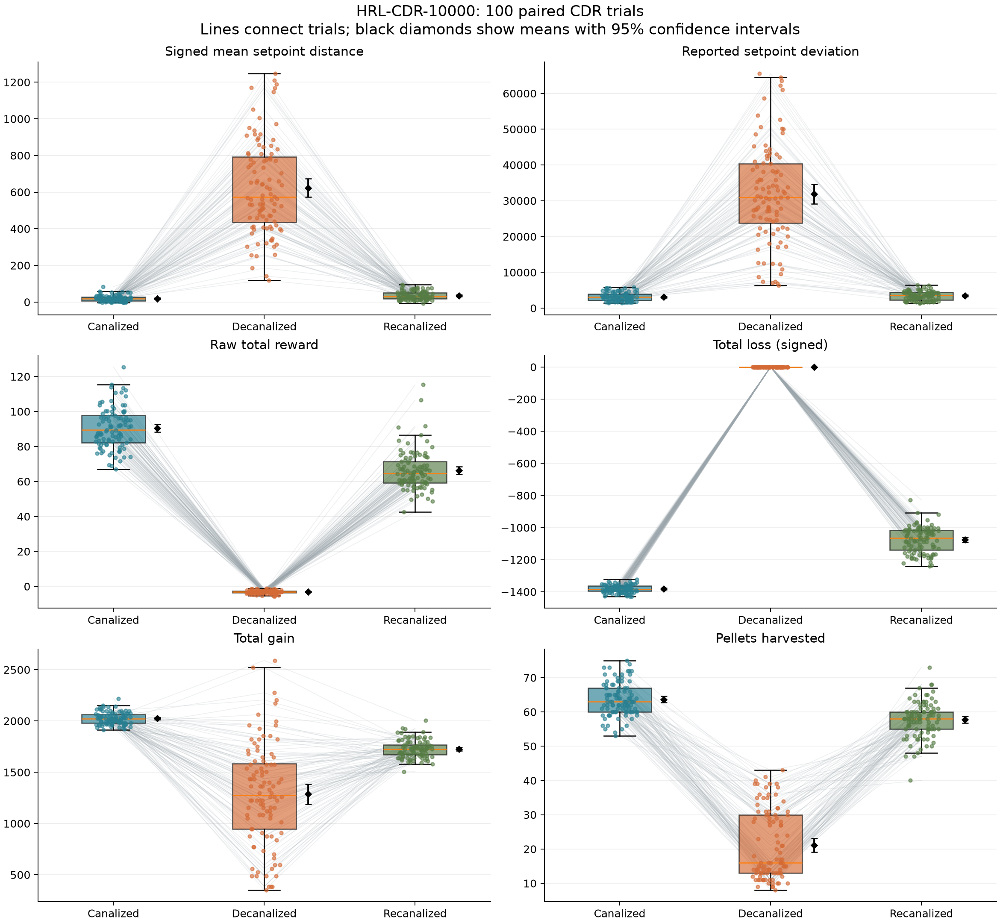

# HRL-CDR-10000 analysis

Input: `D:\Dev\decanalization\analysis\data\HRL-CDR-10000.yml`  
SHA-256: `03dbb63a3807cd8933bf72f77425496a5ee72334f207e18c098d7bf3b9fd6eef`  
Validated: 100 complete trials; 300 phase records; all durations 3000.

## What the results show

**Strong recovery after disruption, with residual differences from the initial phase.**

- Mean signed setpoint distance rises from 18.98 to
  623.49, then falls to 35.42. Recanalization
  reverses 97.3%
  of the increase in the group mean. This describes signed phase averages, not
  a percentage recovery of overall homeostatic control.
- The final signed mean remains 16.44 units above the initial
  mean (paired 95% CI 11.04 to 21.83;
  Holm-adjusted p=5.33e-08).
- Pellets harvested: 63.66 → 21.15 →
  57.80; the final mean is
  9.2% below the initial mean.
- Raw reward: 90.51 → -3.17 →
  66.22; the final mean is
  26.8% below the initial mean.
- Total gain: 2024.41 → 1287.65 →
  1726.31; the final mean is
  14.7% below the initial mean.
- Recorded loss is zero in every decanalized phase. Thus the perturbation changes
  resource balance as well as behavior; phase differences do not isolate learning.
- All 18 phase contrasts except initial-versus-final reported setpoint deviation
  pass the Holm-adjusted 0.05 threshold. That deviation comparison has adjusted
  p=0.081; lack of significance does not demonstrate equivalence.

The trajectory is consistent with regulation returning when canalization returns,
but does not by itself establish adaptation or relearning. The phase averages
cannot distinguish an initial recovery transient from a persistent final offset.

## Phase summaries

| metric | state | n | mean | sd | median | ci95_low | ci95_high |
| --- | --- | --- | --- | --- | --- | --- | --- |
| setpoint-avg | canalized | 100 | 18.983 | 16.15 | 17.591 | 15.778 | 22.187 |
| setpoint-avg | decanalized | 100 | 623.49 | 252.58 | 572.77 | 573.37 | 673.61 |
| setpoint-avg | recanalized | 100 | 35.42 | 22.424 | 29.943 | 30.971 | 39.869 |
| setpoint-dev | canalized | 100 | 3150.4 | 1190.7 | 3077.9 | 2914.1 | 3386.6 |
| setpoint-dev | decanalized | 100 | 31887 | 13739 | 30953 | 29161 | 34613 |
| setpoint-dev | recanalized | 100 | 3462.6 | 1260.4 | 3554.8 | 3212.5 | 3712.7 |
| reward-total | canalized | 100 | 90.515 | 11.518 | 89.388 | 88.229 | 92.8 |
| reward-total | decanalized | 100 | -3.1666 | 0.93309 | -3.0801 | -3.3517 | -2.9814 |
| reward-total | recanalized | 100 | 66.22 | 11.085 | 64.597 | 64.021 | 68.42 |
| loss-total | canalized | 100 | -1382.2 | 23.58 | -1385 | -1386.9 | -1377.5 |
| loss-total | decanalized | 100 | 0 | 0 | 0 | 0 | 0 |
| loss-total | recanalized | 100 | -1075.1 | 80.179 | -1065.1 | -1091 | -1059.2 |
| gain-total | canalized | 100 | 2024.4 | 58.479 | 2023.3 | 2012.8 | 2036 |
| gain-total | decanalized | 100 | 1287.7 | 491.65 | 1277.5 | 1190.1 | 1385.2 |
| gain-total | recanalized | 100 | 1726.3 | 86.174 | 1725.4 | 1709.2 | 1743.4 |
| gains-harvested | canalized | 100 | 63.66 | 4.7295 | 63 | 62.722 | 64.598 |
| gains-harvested | decanalized | 100 | 21.15 | 10.044 | 16 | 19.157 | 23.143 |
| gains-harvested | recanalized | 100 | 57.8 | 5.0493 | 58 | 56.798 | 58.802 |

## Paired phase changes

Changes are after minus before. Two-sided paired t-tests match trial IDs.
Holm adjustment covers all 18 metric/contrast tests. Confidence intervals are
unadjusted 95% intervals for mean changes; Cohen's dz uses the SD of paired changes.
Inference assumes trials provide independent replicates; the file contains no
seed or policy provenance to verify that assumption. These trials do not measure
variation across independently trained policies. Phase and time/order are confounded.

| metric | before | after | mean_change | ci95_low | ci95_high | p_holm | cohens_dz |
| --- | --- | --- | --- | --- | --- | --- | --- |
| setpoint-avg | canalized | decanalized | 604.51 | 554.09 | 654.93 | 9.8387e-42 | 2.379 |
| setpoint-avg | decanalized | recanalized | -588.07 | -638.77 | -537.37 | 1.4326e-40 | -2.3014 |
| setpoint-avg | canalized | recanalized | 16.438 | 11.041 | 21.834 | 5.3326e-08 | 0.60435 |
| setpoint-dev | canalized | decanalized | 28736 | 26003 | 31470 | 4.1634e-37 | 2.0857 |
| setpoint-dev | decanalized | recanalized | -28424 | -31175 | -25673 | 1.4523e-36 | -2.0502 |
| setpoint-dev | canalized | recanalized | 312.2 | -39.179 | 663.58 | 0.080991 | 0.1763 |
| reward-total | canalized | decanalized | -93.681 | -95.987 | -91.376 | 6.6914e-91 | -8.0631 |
| reward-total | decanalized | recanalized | 69.387 | 67.13 | 71.644 | 3.5596e-79 | 6.1007 |
| reward-total | canalized | recanalized | -24.294 | -27.342 | -21.247 | 4.4656e-28 | -1.582 |
| loss-total | canalized | decanalized | 1382.2 | 1377.5 | 1386.9 | 7.9894e-176 | 58.616 |
| loss-total | decanalized | recanalized | -1075.1 | -1091 | -1059.2 | 1.5498e-112 | -13.408 |
| loss-total | canalized | recanalized | 307.11 | 290.61 | 323.61 | 1.3813e-58 | 3.6929 |
| gain-total | canalized | decanalized | -736.76 | -835.12 | -638.41 | 2.909e-26 | -1.4864 |
| gain-total | decanalized | recanalized | 438.66 | 340.04 | 537.28 | 1.1892e-13 | 0.88257 |
| gain-total | canalized | recanalized | -298.11 | -317.99 | -278.22 | 3.9313e-50 | -2.9751 |
| gains-harvested | canalized | decanalized | -42.51 | -44.625 | -40.395 | 1.1839e-61 | -3.988 |
| gains-harvested | decanalized | recanalized | 36.65 | 34.253 | 39.047 | 7.4216e-51 | 3.0341 |
| gains-harvested | canalized | recanalized | -5.86 | -6.9721 | -4.7479 | 4.4563e-17 | -1.0455 |

## Interpretation limits

- `setpoint-avg` is signed: averaging near zero does not establish small absolute error.
  The phase summaries cannot recover time within ±5 or mean absolute error.
- `setpoint-dev` is plotted exactly as logged; its formula and sampling count are
  not specified in this YAML. Do not assume it is a conventional standard deviation.
- Loss is signed, so more negative totals indicate a larger recorded loss magnitude.
- Rewards remain raw. The legacy sandbox normalizes each dataset independently,
  which removes absolute reward differences. Reward functions/objectives can differ.
- Historical means are descriptive only. Matching YAML durations do not establish
  identical environment settings, simulation timing, reward code or sampling.
- A 10000 filename does not mean 10000 trials: this file has 100 trials and no
  training-checkpoint metadata. Aggregate phases cannot establish recovery speed.

## Archived context

| dataset | metric | state | n | mean |
| --- | --- | --- | --- | --- |
| Archived HRL-CDR | setpoint-avg | canalized | 50 | 51.394 |
| Archived HRL-CDR | setpoint-avg | decanalized | 50 | 372.39 |
| Archived HRL-CDR | setpoint-avg | recanalized | 50 | 74.024 |
| Archived HRL-CDR | setpoint-dev | canalized | 50 | 3539.3 |
| Archived HRL-CDR | setpoint-dev | decanalized | 50 | 18669 |
| Archived HRL-CDR | setpoint-dev | recanalized | 50 | 4154 |
| Archived HRL-CDR | reward-total | canalized | 50 | 38.948 |
| Archived HRL-CDR | reward-total | decanalized | 50 | -6.0401 |
| Archived HRL-CDR | reward-total | recanalized | 50 | 29.052 |
| Archived HRL-CDR | loss-total | canalized | 50 | -174.25 |
| Archived HRL-CDR | loss-total | decanalized | 50 | 0 |
| Archived HRL-CDR | loss-total | recanalized | 50 | -140.37 |
| Archived HRL-CDR | gain-total | canalized | 50 | 543.09 |
| Archived HRL-CDR | gain-total | decanalized | 50 | 747.6 |
| Archived HRL-CDR | gain-total | recanalized | 50 | 535.22 |
| Archived HRL-CDR | gains-harvested | canalized | 50 | 18.46 |
| Archived HRL-CDR | gains-harvested | decanalized | 50 | 25.48 |
| Archived HRL-CDR | gains-harvested | recanalized | 50 | 16.4 |
| Archived NF-CDR | setpoint-avg | canalized | 50 | -7.709 |
| Archived NF-CDR | setpoint-avg | decanalized | 50 | 290.67 |
| Archived NF-CDR | setpoint-avg | recanalized | 50 | 25.918 |
| Archived NF-CDR | setpoint-dev | canalized | 50 | 1592.8 |
| Archived NF-CDR | setpoint-dev | decanalized | 50 | 14256 |
| Archived NF-CDR | setpoint-dev | recanalized | 50 | 2177.7 |
| Archived NF-CDR | reward-total | canalized | 50 | 321.93 |
| Archived NF-CDR | reward-total | decanalized | 50 | 477.07 |
| Archived NF-CDR | reward-total | recanalized | 50 | 359.85 |
| Archived NF-CDR | loss-total | canalized | 50 | -205.51 |
| Archived NF-CDR | loss-total | decanalized | 50 | 0 |
| Archived NF-CDR | loss-total | recanalized | 50 | -173.24 |
| Archived NF-CDR | gain-total | canalized | 50 | 449.02 |
| Archived NF-CDR | gain-total | decanalized | 50 | 580.4 |
| Archived NF-CDR | gain-total | recanalized | 50 | 469.36 |
| Archived NF-CDR | gains-harvested | canalized | 50 | 23.92 |
| Archived NF-CDR | gains-harvested | decanalized | 50 | 21.72 |
| Archived NF-CDR | gains-harvested | recanalized | 50 | 22.38 |
| HRL-CDR-10000 | setpoint-avg | canalized | 100 | 18.983 |
| HRL-CDR-10000 | setpoint-avg | decanalized | 100 | 623.49 |
| HRL-CDR-10000 | setpoint-avg | recanalized | 100 | 35.42 |
| HRL-CDR-10000 | setpoint-dev | canalized | 100 | 3150.4 |
| HRL-CDR-10000 | setpoint-dev | decanalized | 100 | 31887 |
| HRL-CDR-10000 | setpoint-dev | recanalized | 100 | 3462.6 |
| HRL-CDR-10000 | reward-total | canalized | 100 | 90.515 |
| HRL-CDR-10000 | reward-total | decanalized | 100 | -3.1666 |
| HRL-CDR-10000 | reward-total | recanalized | 100 | 66.22 |
| HRL-CDR-10000 | loss-total | canalized | 100 | -1382.2 |
| HRL-CDR-10000 | loss-total | decanalized | 100 | 0 |
| HRL-CDR-10000 | loss-total | recanalized | 100 | -1075.1 |
| HRL-CDR-10000 | gain-total | canalized | 100 | 2024.4 |
| HRL-CDR-10000 | gain-total | decanalized | 100 | 1287.7 |
| HRL-CDR-10000 | gain-total | recanalized | 100 | 1726.3 |
| HRL-CDR-10000 | gains-harvested | canalized | 100 | 63.66 |
| HRL-CDR-10000 | gains-harvested | decanalized | 100 | 21.15 |
| HRL-CDR-10000 | gains-harvested | recanalized | 100 | 57.8 |



## Reproduce

From the repository root, with `analysis/requirements.txt` installed:

```powershell
python analysis/analyze_cdr.py
python analysis/sandbox.py
```

The sandbox reproduces the original comparison against archived NF-CDR, including
its independent t-tests and per-dataset reward normalization. Its outputs are in
`legacy-comparison/`; its statistical results do not establish a controlled HRL/NF
comparison. Use the paired tests above to assess the new HRL run's phase changes.
