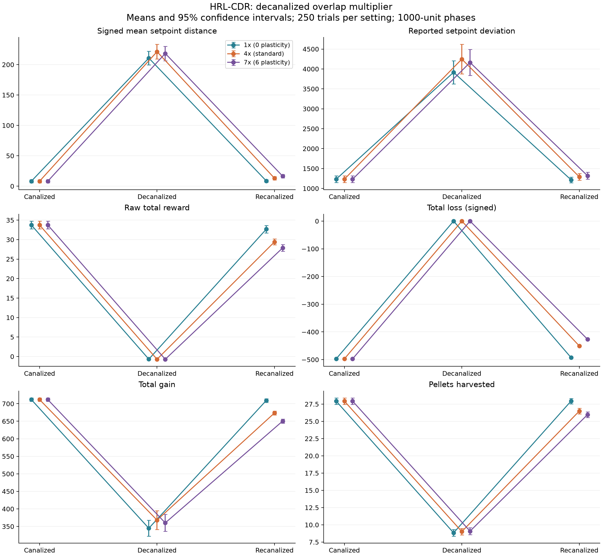
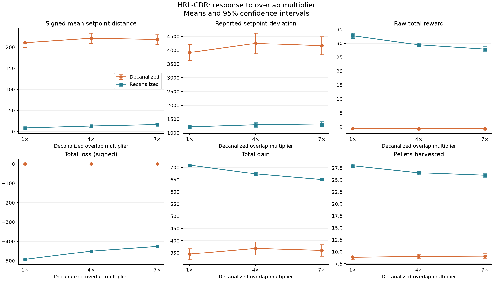

# HRL-CDR plasticity comparison

## Design

User-specified decanalized counting: 0 plasticity = 1 counted overlap per actual
overlap; standard = 4; 6 plasticity = 7. All files contain HRL CDR trials.
The 1× condition still decanalizes; it retains the baseline counting rate rather
than removing the decanalized phase. Every phase has logged duration 1000.
Files have 250, 250, 250 trials respectively.
Only the three named YAML files are used.

## Interpretation

**The main separation is in recanalization, rather than in the size of the
decanalized disturbance.** All three conditions undergo a large positive
setpoint excursion and reduced pellet collection during decanalization. None
of the 18 phase-2 pairwise contrasts survives the specified 36-test Holm family.
This is not proof that the settings are equivalent during that phase.

Final-phase means follow a consistent ordering: increasing overlap counting
from 1× to 4× to 7× corresponds to lower reward, lower resource gain, fewer
pellets, less negative recorded loss, and a higher signed setpoint mean.
The 1× condition ends closest to its starting reward, gain and pellet levels.

Compared with 1×, final-phase reward is 10.0% lower at 4×
and 14.6% lower at 7×. Gain is
5.0% and 8.3% lower,
and pellet count is 5.2% and
7.1% lower respectively.
Those reward, gain and pellet differences from 1× survive Holm correction after
baseline adjustment. Between 4× and 7×, only gain and loss differences survive;
reward and pellet differences do not.

Less negative loss partly offsets the reduced gain. The derived arithmetic
gain-plus-loss total is 216.58,
223.11, and
224.14 for 1×, 4×, and 7×.
Thus the lower reward cannot simply be described as less net recorded resource
input. This arithmetic is descriptive and does not reconstruct the full state
trajectory, resets, or unlogged contributions.

Signed final setpoint means rise from 8.60 to 13.01 to 16.39. For 7× minus 1×,
the baseline-adjusted difference is +7.79 (unadjusted 95% CI 2.81–12.76), but the
primary Holm-adjusted p is 0.0576. Conditional matched-ID analysis gives adjusted
p=0.000566 for that contrast. The state-shift conclusion therefore depends on
the pairing assumption; the resource and reward differences above are clearer.
Signed means are not absolute errors.

This pattern is consistent with a persistent effect of decanalization's overlap
counting on the recanalized environment or behavior. The aggregates cannot
identify the mechanism or demonstrate neural adaptation, faster recovery, or an
optimal setting. No uninterrupted CCC condition is part of this comparison.

## Phase means

| metric | phase | 1x (0 plasticity) | 4x (standard) | 7x (6 plasticity) |
| --- | --- | --- | --- | --- |
| gain-total | 1 | 711.72 | 711.72 | 711.72 |
| gain-total | 2 | 344.82 | 368.06 | 360.08 |
| gain-total | 3 | 709.28 | 673.6 | 650.63 |
| gains-harvested | 1 | 27.936 | 27.936 | 27.936 |
| gains-harvested | 2 | 8.84 | 9.02 | 9.08 |
| gains-harvested | 3 | 27.94 | 26.484 | 25.968 |
| loss-total | 1 | -497.34 | -497.34 | -497.34 |
| loss-total | 2 | 0 | 0 | 0 |
| loss-total | 3 | -492.7 | -450.49 | -426.49 |
| reward-total | 1 | 33.747 | 33.747 | 33.747 |
| reward-total | 2 | -0.68854 | -0.71345 | -0.71482 |
| reward-total | 3 | 32.675 | 29.424 | 27.891 |
| setpoint-avg | 1 | 8.1588 | 8.1588 | 8.1588 |
| setpoint-avg | 2 | 210.75 | 221.26 | 218.34 |
| setpoint-avg | 3 | 8.5974 | 13.011 | 16.386 |
| setpoint-dev | 1 | 1232.3 | 1232.3 | 1232.3 |
| setpoint-dev | 2 | 3916.2 | 4247.6 | 4162.2 |
| setpoint-dev | 3 | 1216.7 | 1291.7 | 1320.3 |

## Phase medians

| metric | phase | 1x (0 plasticity) | 4x (standard) | 7x (6 plasticity) |
| --- | --- | --- | --- | --- |
| gain-total | 1 | 705.65 | 705.65 | 705.65 |
| gain-total | 2 | 315 | 315 | 315 |
| gain-total | 3 | 702.71 | 666.17 | 642.93 |
| gains-harvested | 1 | 28 | 28 | 28 |
| gains-harvested | 2 | 9 | 9 | 9 |
| gains-harvested | 3 | 28 | 27 | 26 |
| loss-total | 1 | -501.58 | -501.58 | -501.58 |
| loss-total | 2 | 0 | 0 | 0 |
| loss-total | 3 | -494.48 | -452.49 | -428.5 |
| reward-total | 1 | 32.54 | 32.54 | 32.54 |
| reward-total | 2 | -0.59366 | -0.64225 | -0.65935 |
| reward-total | 3 | 31.887 | 28.625 | 26.687 |
| setpoint-avg | 1 | 2.4142 | 2.4142 | 2.4142 |
| setpoint-avg | 2 | 207.34 | 212.55 | 211.46 |
| setpoint-avg | 3 | 3.9231 | 6.4014 | 10.107 |
| setpoint-dev | 1 | 1006.1 | 1006.1 | 1006.1 |
| setpoint-dev | 2 | 3282.3 | 3418.1 | 3345.7 |
| setpoint-dev | 3 | 1002.9 | 976.65 | 1015.3 |

## Comparisons adjusted for baseline

For each trial, subtract the initial canalized phase from phase 2 or phase 3.
Compare those changes with two-sided Welch tests between runs. Differences are
higher multiplier minus lower multiplier. A single Holm family covers all 36
tests: six metrics × two phases × three pairwise contrasts. The confidence intervals
are unadjusted 95% intervals. A CI excluding zero need not survive this correction.

| metric | phase | higher | lower | difference | ci95_low | ci95_high | p_holm |
| --- | --- | --- | --- | --- | --- | --- | --- |
| setpoint-avg | 2 | 4x (standard) | 1x (0 plasticity) | 10.51 | -6.6009 | 27.622 | 1 |
| setpoint-avg | 3 | 4x (standard) | 1x (0 plasticity) | 4.4137 | -0.288 | 9.1154 | 1 |
| setpoint-avg | 2 | 7x (6 plasticity) | 1x (0 plasticity) | 7.5902 | -9.2376 | 24.418 | 1 |
| setpoint-avg | 3 | 7x (6 plasticity) | 1x (0 plasticity) | 7.7891 | 2.8136 | 12.765 | 0.05762 |
| setpoint-avg | 2 | 7x (6 plasticity) | 4x (standard) | -2.9201 | -20.414 | 14.574 | 1 |
| setpoint-avg | 3 | 7x (6 plasticity) | 4x (standard) | 3.3754 | -1.6574 | 8.4081 | 1 |
| setpoint-dev | 2 | 4x (standard) | 1x (0 plasticity) | 331.32 | -165.21 | 827.84 | 1 |
| setpoint-dev | 3 | 4x (standard) | 1x (0 plasticity) | 74.977 | -78.112 | 228.07 | 1 |
| setpoint-dev | 2 | 7x (6 plasticity) | 1x (0 plasticity) | 245.95 | -210.43 | 702.33 | 1 |
| setpoint-dev | 3 | 7x (6 plasticity) | 1x (0 plasticity) | 103.58 | -53.459 | 260.62 | 1 |
| setpoint-dev | 2 | 7x (6 plasticity) | 4x (standard) | -85.367 | -597.07 | 426.34 | 1 |
| setpoint-dev | 3 | 7x (6 plasticity) | 4x (standard) | 28.604 | -133.29 | 190.5 | 1 |
| reward-total | 2 | 4x (standard) | 1x (0 plasticity) | -0.024989 | -1.4533 | 1.4033 | 1 |
| reward-total | 3 | 4x (standard) | 1x (0 plasticity) | -3.2517 | -5.0833 | -1.4201 | 0.014834 |
| reward-total | 2 | 7x (6 plasticity) | 1x (0 plasticity) | -0.026339 | -1.4551 | 1.4024 | 1 |
| reward-total | 3 | 7x (6 plasticity) | 1x (0 plasticity) | -4.7845 | -6.6211 | -2.9479 | 1.368e-05 |
| reward-total | 2 | 7x (6 plasticity) | 4x (standard) | -0.0013503 | -1.4311 | 1.4284 | 1 |
| reward-total | 3 | 7x (6 plasticity) | 4x (standard) | -1.5328 | -3.3195 | 0.25392 | 1 |
| loss-total | 2 | 4x (standard) | 1x (0 plasticity) | 0 | -2.8584 | 2.8584 | 1 |
| loss-total | 3 | 4x (standard) | 1x (0 plasticity) | 42.207 | 38.352 | 46.063 | 4.3838e-71 |
| loss-total | 2 | 7x (6 plasticity) | 1x (0 plasticity) | 0 | -2.8584 | 2.8584 | 1 |
| loss-total | 3 | 7x (6 plasticity) | 1x (0 plasticity) | 66.209 | 62.072 | 70.347 | 1.1143e-115 |
| loss-total | 2 | 7x (6 plasticity) | 4x (standard) | 0 | -2.8584 | 2.8584 | 1 |
| loss-total | 3 | 7x (6 plasticity) | 4x (standard) | 24.002 | 19.601 | 28.403 | 1.0642e-22 |
| gain-total | 2 | 4x (standard) | 1x (0 plasticity) | 23.24 | -13.18 | 59.66 | 1 |
| gain-total | 3 | 4x (standard) | 1x (0 plasticity) | -35.674 | -45.694 | -25.654 | 2.762e-10 |
| gain-total | 2 | 7x (6 plasticity) | 1x (0 plasticity) | 15.26 | -19.179 | 49.699 | 1 |
| gain-total | 3 | 7x (6 plasticity) | 1x (0 plasticity) | -58.651 | -68.548 | -48.755 | 2.4091e-26 |
| gain-total | 2 | 7x (6 plasticity) | 4x (standard) | -7.98 | -45.039 | 29.079 | 1 |
| gain-total | 3 | 7x (6 plasticity) | 4x (standard) | -22.977 | -33.162 | -12.793 | 0.00033237 |
| gains-harvested | 2 | 4x (standard) | 1x (0 plasticity) | 0.18 | -0.78878 | 1.1488 | 1 |
| gains-harvested | 3 | 4x (standard) | 1x (0 plasticity) | -1.456 | -2.3191 | -0.5929 | 0.026606 |
| gains-harvested | 2 | 7x (6 plasticity) | 1x (0 plasticity) | 0.24 | -0.70624 | 1.1862 | 1 |
| gains-harvested | 3 | 7x (6 plasticity) | 1x (0 plasticity) | -1.972 | -2.8223 | -1.1217 | 0.00019634 |
| gains-harvested | 2 | 7x (6 plasticity) | 4x (standard) | 0.06 | -0.88123 | 1.0012 | 1 |
| gains-harvested | 3 | 7x (6 plasticity) | 4x (standard) | -0.516 | -1.3847 | 0.35271 | 1 |

## Phase-3 variation across trials

This is a secondary analysis of the spread across trials, distinct from comparing
the mean of `setpoint-dev`. Brown-Forsythe tests (median-centered Levene tests)
assume independent trial samples. Holm correction covers all 12 tests here:
three metrics × (one omnibus comparison plus three pairwise comparisons).
No test survives this correction. This does not demonstrate equal variances.

| metric | comparison | statistic | p | p_holm |
| --- | --- | --- | --- | --- |
| setpoint-avg | all three | 3.3199 | 0.03669 | 0.33021 |
| setpoint-avg | 1x (0 plasticity) vs 4x (standard) | 2.8509 | 0.091948 | 0.55169 |
| setpoint-avg | 1x (0 plasticity) vs 7x (6 plasticity) | 6.6044 | 0.010463 | 0.11509 |
| setpoint-avg | 4x (standard) vs 7x (6 plasticity) | 0.81838 | 0.36609 | 0.73219 |
| setpoint-dev | all three | 2.3171 | 0.099269 | 0.55169 |
| setpoint-dev | 1x (0 plasticity) vs 4x (standard) | 3.5114 | 0.061532 | 0.43072 |
| setpoint-dev | 1x (0 plasticity) vs 7x (6 plasticity) | 3.9307 | 0.047962 | 0.3837 |
| setpoint-dev | 4x (standard) vs 7x (6 plasticity) | 0.0088972 | 0.92489 | 0.92489 |
| reward-total | all three | 4.0162 | 0.018412 | 0.18412 |
| reward-total | 1x (0 plasticity) vs 4x (standard) | 8.1367 | 0.0045182 | 0.054218 |
| reward-total | 1x (0 plasticity) vs 7x (6 plasticity) | 2.236 | 0.13546 | 0.55169 |
| reward-total | 4x (standard) vs 7x (6 plasticity) | 1.7347 | 0.18841 | 0.56524 |

## Baseline alignment

| metric | higher | lower | n | exact_matches | max_absolute_difference |
| --- | --- | --- | --- | --- | --- |
| setpoint-avg | 4x (standard) | 1x (0 plasticity) | 250 | 250 | 0 |
| setpoint-avg | 7x (6 plasticity) | 1x (0 plasticity) | 250 | 250 | 0 |
| setpoint-avg | 7x (6 plasticity) | 4x (standard) | 250 | 250 | 0 |
| setpoint-dev | 4x (standard) | 1x (0 plasticity) | 250 | 250 | 0 |
| setpoint-dev | 7x (6 plasticity) | 1x (0 plasticity) | 250 | 250 | 0 |
| setpoint-dev | 7x (6 plasticity) | 4x (standard) | 250 | 250 | 0 |
| reward-total | 4x (standard) | 1x (0 plasticity) | 250 | 249 | 0.01883 |
| reward-total | 7x (6 plasticity) | 1x (0 plasticity) | 250 | 249 | 0.014116 |
| reward-total | 7x (6 plasticity) | 4x (standard) | 250 | 249 | 0.004714 |
| loss-total | 4x (standard) | 1x (0 plasticity) | 250 | 250 | 0 |
| loss-total | 7x (6 plasticity) | 1x (0 plasticity) | 250 | 250 | 0 |
| loss-total | 7x (6 plasticity) | 4x (standard) | 250 | 250 | 0 |
| gain-total | 4x (standard) | 1x (0 plasticity) | 250 | 250 | 0 |
| gain-total | 7x (6 plasticity) | 1x (0 plasticity) | 250 | 250 | 0 |
| gain-total | 7x (6 plasticity) | 4x (standard) | 250 | 250 | 0 |
| gains-harvested | 4x (standard) | 1x (0 plasticity) | 250 | 250 | 0 |
| gains-harvested | 7x (6 plasticity) | 1x (0 plasticity) | 250 | 250 | 0 |
| gains-harvested | 7x (6 plasticity) | 4x (standard) | 250 | 250 | 0 |

## Limits

- The overlap mapping comes from the user; YAML lacks configuration, checkpoint,
  and seed metadata. Identical baselines support comparability but do not prove
  all settings or policies were held fixed.
- Primary tests do not assume cross-run pairing. Conditional trial-ID paired
  sensitivity tests are saved separately, with their own 36-test Holm family.
- Inference assumes independent trial replicates, not independent trained policies.
- `setpoint-avg` is signed. Closer group means to zero do not establish lower
  mean absolute error; the files cannot recover time within ±5 or recovery speed.
- `setpoint-dev` is used as logged, with no verified formula or sample count.
- Loss is signed: more negative means greater recorded loss magnitude.
- The analysis cannot establish the mechanism of a final-phase difference or
  whether it reflects learning, altered resources, or recovery transients.
- Nonsignificant tests do not establish equivalence or an optimal multiplier.

## Provenance and reproduction

- 1x (0 plasticity): `D:\Dev\decanalization\analysis\data\HRL-CDR-0-plasticity.yml`; SHA-256 `018088023978d8d0f6284d47138a3469bda198179b457a3d3252793c862cfec4`
- 4x (standard): `D:\Dev\decanalization\analysis\data\HRL-CDR-10000.yml`; SHA-256 `bd4dd51a466281dcae05a65bae374c5bf7a6eb9733a9ee212965aedb273600b9`
- 7x (6 plasticity): `D:\Dev\decanalization\analysis\data\HRL-CDR-6-plasticity.yml`; SHA-256 `ebb288353dfb5fe2327f9e034e69bf6c3f745bc600396855000a9e94c4010157`

Run `python analysis/compare_plasticity.py` with analysis/requirements.txt installed.

