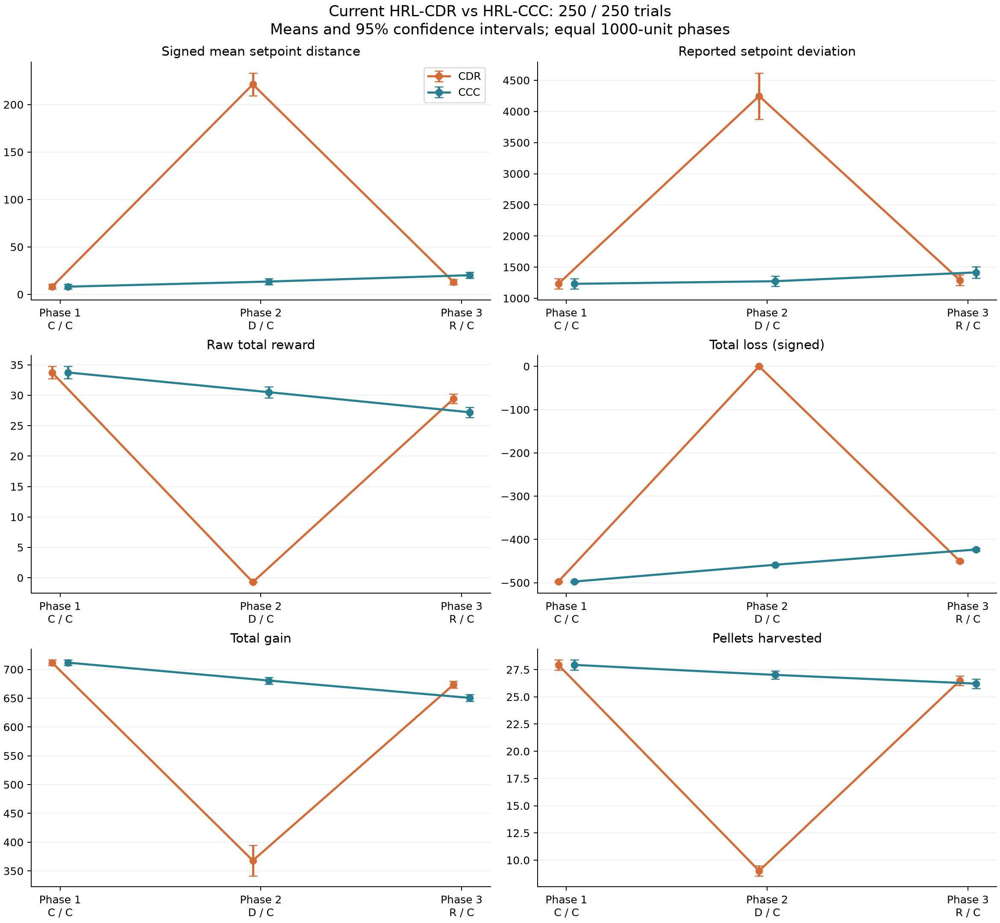

# HRL-CDR vs HRL-CCC at 10000

## Input versions matter

The linked `HRL-CDR-10000/` report is an earlier analysis: 100
trials, with durations [3000]. The current CDR
and CCC YAML files each have 250 trials and duration
1000 per phase. The primary comparison below uses the
current YAML files. The earlier report is preserved. Its requested comparison
against CCC appears separately below and in `saved_cdr_vs_current_ccc.csv`.

## Interpretation

For the current matched-duration files, decanalization produces a large phase-2
disruption, followed by recovery. CCC also changes over time, so comparing CDR's
final phase only to its own baseline overstates evidence for a persistent deficit
relative to uninterrupted canalization. At phase 3, CDR has a lower positive
signed setpoint mean and higher reward than CCC, while pellet collection is
similar. A lower positive signed mean is not proof of lower absolute error.

The final-phase differences after subtracting each trial's baseline are:

- Signed setpoint mean: -7.22 (95% CI -12.38 to -2.05; Holm-adjusted p=0.0252).
- Raw reward: +2.21 (95% CI 0.42 to 4.00; Holm-adjusted p=0.0462).
- Total gain: +23.02 (95% CI 12.39 to 33.66; Holm-adjusted p=0.000125).
- Pellets harvested: +0.27 (95% CI -0.61 to 1.15; Holm-adjusted p=0.55).

Intervals are unadjusted; p-values use the separate 12-test change-contrast family.
The pellet comparison does not establish equivalence. The evidence supports a
large temporary disruption without a final-phase deficit relative to CCC on
these measures; it does not establish that decanalization improves learning.
The resource trajectory changes too: phase-2 loss is zero in CDR, and final-phase
loss remains more negative in CDR than CCC.

For the **older saved results explicitly linked in the request**, final signed
setpoint mean is 35.42 versus 20.23 in CCC. Final reward rates are 22.07 versus
27.21, and pellet rates are 19.27 versus 26.22 per 1000 logged duration units.
Those differences coexist with substantial baseline differences and unequal
elapsed-time windows, so they cannot isolate an effect of the CDR sequence.
The updated CDR file and the old report must not be treated as the same dataset.

## Current files: phase means

| metric | phase | CDR | CCC |
| --- | --- | --- | --- |
| gain-total | 1 | 711.72 | 711.72 |
| gain-total | 2 | 368.06 | 680.65 |
| gain-total | 3 | 673.6 | 650.58 |
| gains-harvested | 1 | 27.936 | 27.936 |
| gains-harvested | 2 | 9.02 | 27.016 |
| gains-harvested | 3 | 26.484 | 26.216 |
| loss-total | 1 | -497.34 | -497.34 |
| loss-total | 2 | 0 | -458.53 |
| loss-total | 3 | -450.49 | -423.41 |
| reward-total | 1 | 33.747 | 33.747 |
| reward-total | 2 | -0.71345 | 30.51 |
| reward-total | 3 | 29.424 | 27.21 |
| setpoint-avg | 1 | 8.1588 | 8.1588 |
| setpoint-avg | 2 | 221.26 | 13.533 |
| setpoint-avg | 3 | 13.011 | 20.227 |
| setpoint-dev | 1 | 1232.3 | 1232.3 |
| setpoint-dev | 2 | 4247.6 | 1274.3 |
| setpoint-dev | 3 | 1291.7 | 1415.5 |

## Between-run comparisons

Differences are CDR minus CCC. Primary tests use independent-sample Welch t-tests,
since matching IDs alone do not establish paired experimental provenance. Holm
correction covers these 18 comparisons. The 95% CIs are unadjusted.

| metric | phase | difference | ci95_low | ci95_high | p_holm |
| --- | --- | --- | --- | --- | --- |
| setpoint-avg | 1 | 0 | -3.4476 | 3.4476 | 1 |
| setpoint-avg | 2 | 207.73 | 195.27 | 220.18 | 9.013e-97 |
| setpoint-avg | 3 | -7.2162 | -11.417 | -3.0157 | 0.0071719 |
| setpoint-dev | 1 | 0 | -116.57 | 116.57 | 1 |
| setpoint-dev | 2 | 2973.3 | 2592.9 | 3353.7 | 7.138e-38 |
| setpoint-dev | 3 | -123.84 | -251.93 | 4.2474 | 0.46451 |
| reward-total | 1 | 7.7128e-05 | -1.4223 | 1.4225 | 1 |
| reward-total | 2 | -31.223 | -32.133 | -30.314 | 1.6413e-161 |
| reward-total | 3 | 2.2134 | 1.0579 | 3.3689 | 0.0018759 |
| loss-total | 1 | 0 | -2.8584 | 2.8584 | 1 |
| loss-total | 2 | 458.53 | 456.56 | 460.5 | 0 |
| loss-total | 3 | -27.078 | -30.589 | -23.568 | 2.9746e-41 |
| gain-total | 1 | 0 | -6.9979 | 6.9979 | 1 |
| gain-total | 2 | -312.59 | -339.82 | -285.36 | 2.3283e-63 |
| gain-total | 3 | 23.024 | 14.647 | 31.4 | 1.138e-06 |
| gains-harvested | 1 | 0 | -0.65988 | 0.65988 | 1 |
| gains-harvested | 2 | -17.996 | -18.594 | -17.398 | 1.4414e-221 |
| gains-harvested | 3 | 0.268 | -0.33937 | 0.87537 | 1 |

## Changes relative to each run's phase 1

Each trial's phase-1 value is subtracted before comparing runs with Welch tests.
The difference is (CDR phase j minus CDR phase 1) minus (CCC phase j minus CCC
phase 1). Holm correction covers these 12 comparisons separately. These contrasts
account for observed baseline differences, but are not proof of a causal effect.

| metric | phase | cdr_change | ccc_change | difference | ci95_low | ci95_high | p_holm |
| --- | --- | --- | --- | --- | --- | --- | --- |
| setpoint-avg | 2 | 213.1 | 5.3743 | 207.73 | 194.67 | 220.78 | 1.4828e-93 |
| setpoint-avg | 3 | 4.8523 | 12.069 | -7.2162 | -12.384 | -2.0482 | 0.025207 |
| setpoint-dev | 2 | 3015.3 | 41.959 | 2973.3 | 2569.6 | 3377 | 2.4417e-35 |
| setpoint-dev | 3 | 59.374 | 183.22 | -123.84 | -291.61 | 43.927 | 0.29519 |
| reward-total | 2 | -34.46 | -3.2367 | -31.223 | -32.879 | -29.568 | 2.7501e-140 |
| reward-total | 3 | -4.323 | -6.5364 | 2.2133 | 0.42468 | 4.002 | 0.0462 |
| loss-total | 2 | 497.34 | 38.811 | 458.53 | 455 | 462.06 | 0 |
| loss-total | 3 | 46.851 | 73.929 | -27.078 | -31.782 | -22.374 | 1.1975e-25 |
| gain-total | 2 | -343.66 | -31.078 | -312.59 | -341.08 | -284.09 | 6.8493e-61 |
| gain-total | 3 | -38.121 | -61.145 | 23.024 | 12.39 | 33.657 | 0.00012547 |
| gains-harvested | 2 | -18.916 | -0.92 | -17.996 | -18.907 | -17.085 | 1.0321e-150 |
| gains-harvested | 3 | -1.452 | -1.72 | 0.268 | -0.61201 | 1.148 | 0.54988 |

## Trial alignment sensitivity

The files have the same trial IDs. Baseline alignment is shown below. The project
documents reproducible environment streams, but seed/checkpoint/run provenance is
absent from the YAML. `paired_id_sensitivity.csv` therefore reports conditional
paired tests as a sensitivity analysis (18-test Holm family), not the primary test.

| metric | exactly_equal_trials | n | max_absolute_difference |
| --- | --- | --- | --- |
| setpoint-avg | 250 | 250 | 0 |
| setpoint-dev | 250 | 250 | 0 |
| reward-total | 249 | 250 | 0.019282 |
| loss-total | 250 | 250 | 0 |
| gain-total | 250 | 250 | 0 |
| gains-harvested | 250 | 250 | 0 |

## Requested saved CDR results vs current CCC

These observations have unequal phase durations and different sample sizes.
Additive totals are converted to rates per 1000 logged duration units. Setpoint
averages and reported deviation are left as logged. Rate conversion does not
correct duration-dependent dynamics or align elapsed time: saved CDR phase 1 spans
the same logged duration as all three CCC phases. Tests are exploratory Welch
tests (18-test Holm family); this is not a controlled comparison.

| metric | phase | units | saved_cdr_mean | ccc_mean | difference | p_holm |
| --- | --- | --- | --- | --- | --- | --- |
| setpoint-avg | 1 | as logged | 18.983 | 8.1588 | 10.824 | 3.131e-07 |
| setpoint-avg | 2 | as logged | 623.49 | 13.533 | 609.96 | 2.1859e-42 |
| setpoint-avg | 3 | as logged | 35.42 | 20.227 | 15.193 | 3.131e-07 |
| setpoint-dev | 1 | as logged | 3150.4 | 1232.3 | 1918.1 | 2.8258e-29 |
| setpoint-dev | 2 | as logged | 31887 | 1274.3 | 30612 | 2.0039e-39 |
| setpoint-dev | 3 | as logged | 3462.6 | 1415.5 | 2047.1 | 1.4642e-29 |
| reward-total | 1 | per 1000 logged duration units | 30.172 | 33.747 | -3.5751 | 1.4268e-07 |
| reward-total | 2 | per 1000 logged duration units | -1.0555 | 30.51 | -31.565 | 5.773e-163 |
| reward-total | 3 | per 1000 logged duration units | 22.073 | 27.21 | -5.1368 | 6.9123e-17 |
| loss-total | 1 | per 1000 logged duration units | -460.73 | -497.34 | 36.613 | 9.8093e-90 |
| loss-total | 2 | per 1000 logged duration units | 0 | -458.53 | 458.53 | 0 |
| loss-total | 3 | per 1000 logged duration units | -358.36 | -423.41 | 65.053 | 1.0235e-47 |
| gain-total | 1 | per 1000 logged duration units | 674.8 | 711.72 | -36.919 | 1.1879e-25 |
| gain-total | 2 | per 1000 logged duration units | 429.22 | 680.65 | -251.43 | 2.3929e-27 |
| gain-total | 3 | per 1000 logged duration units | 575.44 | 650.58 | -75.143 | 1.4271e-47 |
| gains-harvested | 1 | per 1000 logged duration units | 21.22 | 27.936 | -6.716 | 6.983e-73 |
| gains-harvested | 2 | per 1000 logged duration units | 7.05 | 27.016 | -19.966 | 4.2755e-104 |
| gains-harvested | 3 | per 1000 logged duration units | 19.267 | 26.216 | -6.9493 | 7.5827e-77 |

## Limits

- Signed setpoint averages cannot recover mean absolute error or time within ±5.
- `setpoint-dev` is used as logged; its formula and sampling count are unspecified.
  Its magnitude should not be compared across durations as a verified standard deviation.
- Trial-level inference assumes independent replicates; trials do not establish
  variation across independently trained policies. Equal first phases do not prove equivalence.
- A final-phase difference cannot distinguish carryover, resource changes, recovery
  transients, or learning. Resource gain/loss totals directly differ between conditions.
- Raw rewards are not min-max normalized. A 10000 filename does not verify the
  checkpoint or reward configuration used to produce the run.

## Provenance and reproduction

- CDR: `D:\Dev\decanalization\analysis\data\HRL-CDR-10000.yml`; SHA-256 `bd4dd51a466281dcae05a65bae374c5bf7a6eb9733a9ee212965aedb273600b9`
- CCC: `D:\Dev\decanalization\analysis\data\HRL-CCC-10000.yml`; SHA-256 `0c2421bc7ce911843865612b02d27c0c3d0a50e61334d808015cdce84c6ddd99`
- Saved CDR rows: `D:\Dev\decanalization\analysis\results\HRL-CDR-10000\sequences.csv`; SHA-256 `7907da37cd7a65ebbaeabf9924bb57eaf9603d7e7f952d3c98f539c17b26394d`

Run `python analysis/compare_cdr_ccc.py` with analysis/requirements.txt installed.

