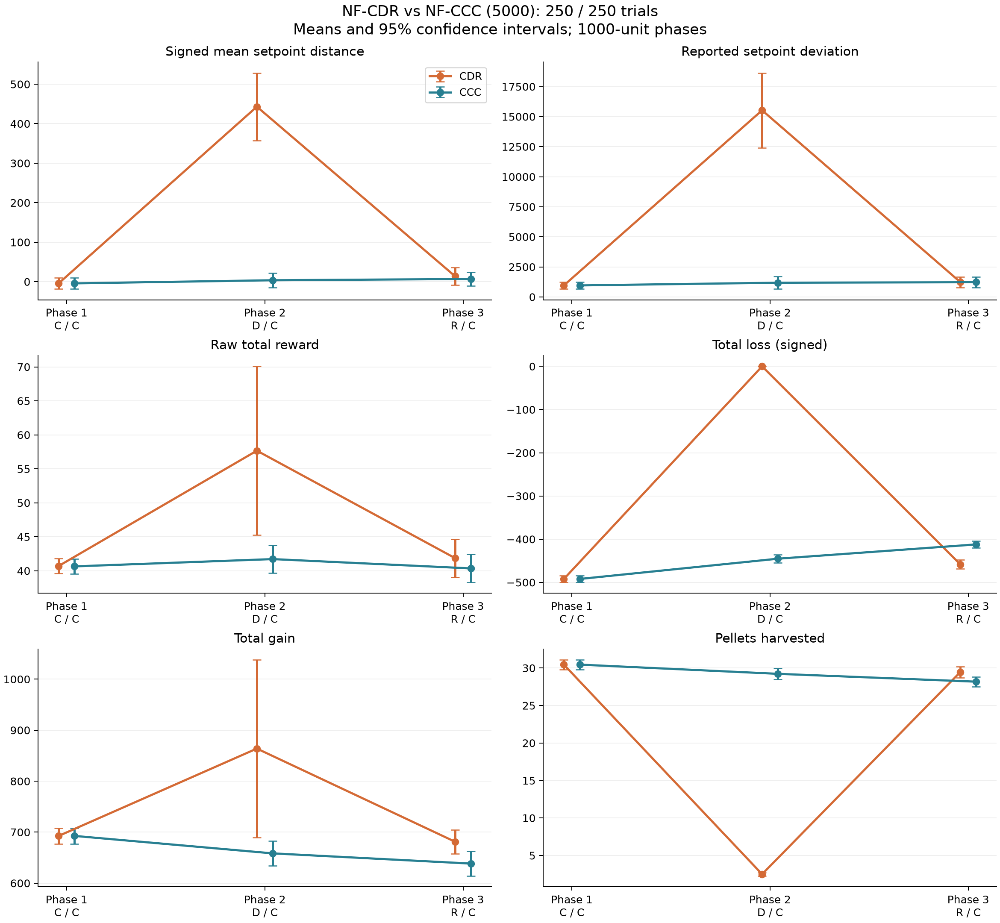
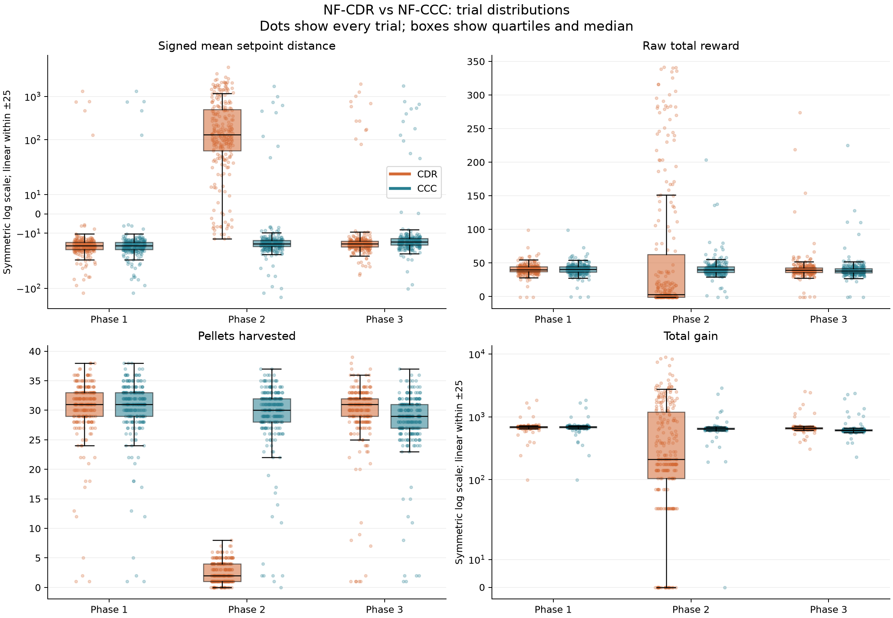

# NF-CDR vs NF-CCC (5000)

Validated complete trials: CDR 250, CCC 250.
Every trial has all three ordered phases; each phase has logged duration 1000.
Only the two named YAML inputs are used. Rewards are raw; totals require no duration rescaling.

## Interpretation of this NF run

Decanalization is associated with a large positive excursion in signed setpoint
mean and a collapse in pellet count. Mean phase-2 signed distance is 443.05 versus
3.76 under CCC; median distance is 130.33 versus -15.40. Pellet means are 2.50 versus
29.22, a 91.4% reduction relative to CCC.

The apparent reward increase is not representative of the typical trial: phase-2
CDR reward has mean 57.67 but median 3.33 (CCC mean 41.72, median 39.77). CDR phase-2
gain has mean 863.94 but median 210.00 (CCC median 646.50). Extreme trials pull means
upward. Neither reward nor gain differences survive the specified Holm correction.
Higher mean reward here is not evidence of better regulation.

Final-phase behavior returns near the uninterrupted condition at the group level.
Median signed distance is -15.56 in CDR and -14.47 in CCC, compared with -16.55
initially in both. Positive final means (13.85 and 6.95) reflect the long positive
tail and must not be read as the typical trial or as MAE.

- Baseline-adjusted setpoint-avg: CDR minus CCC = +6.90; 95% CI [-28.13, 41.93]; Holm-adjusted p=1.
- Baseline-adjusted reward-total: CDR minus CCC = +1.46; 95% CI [-2.42, 5.33]; Holm-adjusted p=1.
- Baseline-adjusted gains-harvested: CDR minus CCC = +1.28; 95% CI [-0.05, 2.62]; Holm-adjusted p=0.238.
- Baseline-adjusted loss-total: CDR minus CCC = -46.21; 95% CI [-64.19, -28.22]; Holm-adjusted p=5.03e-06.

There is no statistically resolved final difference in signed state, logged
deviation, reward, gain, or pellets after multiplicity correction. Loss remains
more negative in CDR: resource balance has not fully converged. Wide intervals
and nonsignificant tests do not establish equivalent regulation or rule out
meaningful effects. This is evidence of a temporary disruption with broad
behavioral recovery, rather than proof of adaptation or complete recovery.

## Phase means

| metric | phase | CDR | CCC |
| --- | --- | --- | --- |
| gain-total | 1 | 692.63 | 692.63 |
| gain-total | 2 | 863.94 | 658.39 |
| gain-total | 3 | 681.19 | 638.38 |
| gains-harvested | 1 | 30.452 | 30.452 |
| gains-harvested | 2 | 2.5 | 29.224 |
| gains-harvested | 3 | 29.46 | 28.176 |
| loss-total | 1 | -492.09 | -492.09 |
| loss-total | 2 | 0 | -445.17 |
| loss-total | 3 | -458.35 | -412.14 |
| reward-total | 1 | 40.705 | 40.647 |
| reward-total | 2 | 57.671 | 41.72 |
| reward-total | 3 | 41.862 | 40.35 |
| setpoint-avg | 1 | -4.1235 | -4.1235 |
| setpoint-avg | 2 | 443.05 | 3.7607 |
| setpoint-avg | 3 | 13.846 | 6.9455 |
| setpoint-dev | 1 | 959.11 | 959.11 |
| setpoint-dev | 2 | 15527 | 1184 |
| setpoint-dev | 3 | 1234.2 | 1224.7 |

## Phase medians

| metric | phase | CDR | CCC |
| --- | --- | --- | --- |
| gain-total | 1 | 688.55 | 688.55 |
| gain-total | 2 | 210 | 646.5 |
| gain-total | 3 | 662.57 | 611.57 |
| gains-harvested | 1 | 31 | 31 |
| gains-harvested | 2 | 2 | 30 |
| gains-harvested | 3 | 31 | 29 |
| loss-total | 1 | -506.29 | -506.29 |
| loss-total | 2 | 0 | -460.41 |
| loss-total | 3 | -476.98 | -424.65 |
| reward-total | 1 | 40.273 | 40.367 |
| reward-total | 2 | 3.325 | 39.773 |
| reward-total | 3 | 39.593 | 38.277 |
| setpoint-avg | 1 | -16.552 | -16.552 |
| setpoint-avg | 2 | 130.33 | -15.401 |
| setpoint-avg | 3 | -15.559 | -14.471 |
| setpoint-dev | 1 | 531.45 | 531.45 |
| setpoint-dev | 2 | 3877.6 | 520.82 |
| setpoint-dev | 3 | 530.91 | 505.52 |

Means and medians can differ substantially. Inspect both and the individual-trial
distribution plot before interpreting average reward or average signed state.

## Between-condition comparisons

Differences are CDR minus CCC. Two-sided Welch tests; Holm adjustment across
these 18 comparisons. Confidence intervals are unadjusted 95% intervals.

| metric | phase | difference | ci95_low | ci95_high | p_holm |
| --- | --- | --- | --- | --- | --- |
| setpoint-avg | 1 | 0 | -20.076 | 20.076 | 1 |
| setpoint-avg | 2 | 439.29 | 351.93 | 526.66 | 1.0035e-18 |
| setpoint-avg | 3 | 6.9 | -21.48 | 35.28 | 1 |
| setpoint-dev | 1 | 0 | -415.32 | 415.32 | 1 |
| setpoint-dev | 2 | 14343 | 11191 | 17496 | 9.3278e-16 |
| setpoint-dev | 3 | 9.4565 | -626.44 | 645.35 | 1 |
| reward-total | 1 | 0.057256 | -1.5165 | 1.6311 | 1 |
| reward-total | 2 | 15.951 | 3.3777 | 28.524 | 0.14812 |
| reward-total | 3 | 1.5123 | -1.9595 | 4.9841 | 1 |
| loss-total | 1 | 0 | -11.276 | 11.276 | 1 |
| loss-total | 2 | 445.17 | 436.16 | 454.19 | 8.4648e-199 |
| loss-total | 3 | -46.208 | -59.428 | -32.988 | 2.9144e-10 |
| gain-total | 1 | 0 | -22.094 | 22.094 | 1 |
| gain-total | 2 | 205.55 | 29.775 | 381.32 | 0.22087 |
| gain-total | 3 | 42.811 | 9.3296 | 76.293 | 0.14812 |
| gains-harvested | 1 | 0 | -0.9061 | 0.9061 | 1 |
| gains-harvested | 2 | -26.724 | -27.497 | -25.951 | 2.2226e-180 |
| gains-harvested | 3 | 1.284 | 0.29074 | 2.2773 | 0.14812 |

## Changes relative to phase 1

Subtract each trial's phase 1 before comparing CDR versus CCC with Welch tests.
Difference = (CDR phase j minus phase 1) minus (CCC phase j minus phase 1).
Holm adjustment covers these 12 comparisons separately. Intervals are unadjusted.
This preserves within-trial dependence without assuming cross-run matching.

| metric | phase | cdr_change | ccc_change | difference | ci95_low | ci95_high | p_holm |
| --- | --- | --- | --- | --- | --- | --- | --- |
| setpoint-avg | 2 | 447.18 | 7.8842 | 439.29 | 349.72 | 528.86 | 2.9216e-18 |
| setpoint-avg | 3 | 17.969 | 11.069 | 6.9 | -28.131 | 41.931 | 1 |
| setpoint-dev | 2 | 14568 | 224.87 | 14343 | 11150 | 17537 | 1.1495e-15 |
| setpoint-dev | 3 | 275.06 | 265.6 | 9.4565 | -759.04 | 777.95 | 1 |
| reward-total | 2 | 16.967 | 1.073 | 15.894 | 3.3211 | 28.466 | 0.093953 |
| reward-total | 3 | 1.1574 | -0.29763 | 1.455 | -2.4242 | 5.3342 | 1 |
| loss-total | 2 | 492.09 | 46.916 | 445.17 | 430.52 | 459.82 | 2.0945e-208 |
| loss-total | 3 | 33.745 | 79.953 | -46.208 | -64.191 | -28.224 | 5.0276e-06 |
| gain-total | 2 | 171.31 | -34.242 | 205.55 | 28.305 | 382.79 | 0.13921 |
| gain-total | 3 | -11.44 | -54.252 | 42.811 | 2.2192 | 83.403 | 0.19383 |
| gains-harvested | 2 | -27.952 | -1.228 | -26.724 | -27.884 | -25.564 | 1.5683e-169 |
| gains-harvested | 3 | -0.992 | -2.276 | 1.284 | -0.051091 | 2.6191 | 0.23759 |

## Baseline alignment and limits

| metric | n | exact_matches | max_absolute_difference |
| --- | --- | --- | --- |
| setpoint-avg | 250 | 250 | 0 |
| setpoint-dev | 250 | 250 | 0 |
| reward-total | 250 | 120 | 6.8879 |
| loss-total | 250 | 250 | 0 |
| gain-total | 250 | 250 | 0 |
| gains-harvested | 250 | 250 | 0 |

- Matching trial IDs or identical baselines do not verify matched seeds or policies.
  If IDs align, conditional paired tests are in `paired_id_sensitivity.csv`
  (a separate 18-test Holm family). Primary tests use Welch comparisons.
- Inference assumes independent trial replicates and does not measure variation
  across independently trained policies. The YAML omits seed/configuration metadata.
- Signed setpoint means are not mean absolute errors. Negative values represent
  a signed offset; comparing closeness of group means to zero cannot establish MAE.
- `setpoint-dev` is used exactly as logged; its formula and sampling count are not
  specified here. Do not interpret it as a verified conventional standard deviation.
- More gain or higher NF reward need not imply better homeostatic regulation.
  Resource gain/loss changes can explain behavior without learning or adaptation.
- Phase averages cannot establish recovery speed. Nonsignificant differences
  do not establish equivalence, and a 5000 filename does not verify checkpoint provenance.

## Provenance

- CDR: `D:\Dev\decanalization\analysis\data\NF-CDR-5000.yml`; SHA-256 `25cb88ce0a236b5885e5ef060cfeacf4a368c01b85cab6b2015bca57f5631cb3`
- CCC: `D:\Dev\decanalization\analysis\data\NF-CCC-5000.yml`; SHA-256 `3fd14851df4009f6786448c45ea03e6136f0fb6dfc4ca1602f571f74be6bd995`

Reproduce: `python analysis/compare_conditions.py --reward NF --checkpoint 5000`

